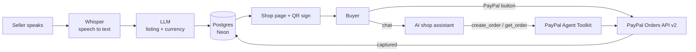

# Spoken Shop 🎤🛒

**Sell anything by voice. A seller speaks a product in their own language, and AI turns it into a shop with PayPal checkout, a printable QR sign, and an AI shop assistant that sells for them in the buyer's language.**

Hundreds of millions of people earn a living in the informal economy (street vendors, home cooks, tailors, artisans), and many of them take cash only. Online selling tools assume you can type, read English and manage a dashboard. Spoken Shop removes all three: if you can talk, you can sell online.

- **Live demo:** https://spoken-shop.onrender.com
- **Demo video:** https://youtu.be/CLMHhluKKsY
- **Built for:** The PayPal AI Hackathon 2026

---

## Try it in 2 minutes (for judges)

> ⏳ The demo runs on Render's free tier, which sleeps when idle. **The first page load can take up to a minute.** After that it's fast.

1. **Open https://spoken-shop.onrender.com/ **
2. **Be the seller:** tap **🎤 Tap to speak** and say something like *"Idly, 40 rupees, 100 pieces"*, in any language. Or type it in the box and press **Go** if you'd rather not use a microphone.
3. Check the listing (non-USD prices are converted to USD automatically), then press **Looks good — create my shop link**. You'll get a shop link and a **printable QR stall sign**.
4. **Be the buyer:** open the shop link, or scan the QR code with your phone.
   - Ask the **💬 Ask the shop** assistant a question in any language, for example *"Is this vegetarian?"* or *"¿Cuánto cuesta?"*
   - Try to negotiate, like *"Can I get 50% off?"* The assistant politely refuses, because the price is fixed by the seller.
   - Say *"I want 2"*. The assistant creates a PayPal order and shows a **Pay with PayPal** button.
5. **Pay with the PayPal sandbox buyer account** (test money only):
   - **Email:** `spokenshop.judge@personal.example.com`
   - **Password:** `Judge456$`

   > 💡 **Using Safari?** Safari's tracking protection can block PayPal's sandbox login popup. If you see "Something went wrong", use **Chrome**, or buy through the **💬 Ask the shop** chat, which opens PayPal as a full page.
6. You'll see **Payment complete**, and the stock count drops.

You can also pay with the regular PayPal button on the shop page, which uses the same sandbox account.

---

## What it does

| For the **seller** | For the **buyer** |
|---|---|
| Speak a product, price and stock in their own language | Scan a QR code or open a link, with no app to install |
| AI writes an English listing, keeping local names like *idly* | Chat with an AI shop assistant in their own language, by text or voice |
| Prices in local currency are converted to USD | Buy right from the chat with PayPal |
| Get a shareable shop link and a printable QR stall sign | Stock updates instantly after payment |

---

## How it uses PayPal + AI

### PayPal
- **PayPal JavaScript SDK + Orders API v2:** the PayPal button on each shop page creates and captures orders on the server.
- **PayPal Agent Toolkit (`@paypal/agent-toolkit`):** the AI shop assistant uses the toolkit's `create_order` and `get_order` tools to create a real PayPal order for the quantity the buyer asks for, then returns PayPal's approval link as a button in the chat. After approval, the server verifies and captures the order and updates stock.

### AI
- **Speech-to-text:** OpenAI Whisper turns the seller's (or buyer's) voice into text in 50+ languages.
- **Listing generation:** an LLM (`gpt-4o-mini`) turns one spoken sentence into a structured listing (name, description, price, currency, stock, language). It's instructed to translate faithfully and never invent claims.
- **Shop assistant:** the same model answers buyer questions using only the seller's product facts and replies in the buyer's language. It calls one checkout tool when the buyer wants to buy.

### Guardrails (AI near money, done safely)
- **The AI never sets the price.** It only chooses the quantity. The price comes from the database, so a buyer can't talk it into a discount.
- **It can't oversell.** Requests above the available stock are refused.
- **Payments are verified on the server.** Stock only drops after PayPal confirms the order is approved and captured, and a completed order is never counted twice.
- **No secrets in the browser.** All PayPal and OpenAI calls run on the server.

---

## Architecture



**Stack:** Next.js (App Router, TypeScript), Tailwind CSS, PayPal JS SDK, PayPal Orders API v2, PayPal Agent Toolkit, OpenAI (Whisper + gpt-4o-mini), Postgres on Neon, hosted on **Render**.

| Path | What it does |
|---|---|
| `app/page.tsx` | Seller page: voice input, listing editor, shop link, QR stall sign |
| `app/p/[id]/page.tsx` | Buyer shop page |
| `app/p/[id]/BuyBox.tsx` | PayPal checkout button |
| `app/p/[id]/BuyerChat.tsx` | AI shop assistant (text and voice) |
| `app/p/[id]/paid/` | Return page after paying from the chat |
| `app/api/transcribe` | Audio → text (Whisper) |
| `app/api/listing` | Text → listing (LLM) |
| `app/api/chat` | Shop assistant with the PayPal checkout tool |
| `app/api/chat/capture` | Verifies and captures chat orders |
| `app/api/paypal/*` | Creates and captures orders for the PayPal button |
| `lib/ai.ts` | Whisper, listing prompt, currency conversion |
| `lib/paypalAgent.ts` | PayPal Agent Toolkit setup and order helpers |
| `lib/store.ts` | Products in Postgres |

---

## Run it locally

Requires **Node.js 20+**.

```bash
git clone https://github.com/gocool380a/spoken-shop
cd spoken-shop
npm install
cp .env.example .env.local   # then fill in your keys
npm run dev
```

Open http://localhost:3000.

**Environment variables** (see `.env.example`):

| Name | Where to get it |
|---|---|
| `PAYPAL_CLIENT_ID`, `PAYPAL_CLIENT_SECRET` | developer.paypal.com → Apps & Credentials → **Sandbox** |
| `OPENAI_API_KEY` | platform.openai.com → API keys |
| `OPENAI_MODEL` | e.g. `gpt-4o-mini` |
| `DATABASE_URL` | Any Postgres connection string (e.g. a free Neon project). The table is created automatically. |

---

## Current limitations (honest notes)

- **Sandbox only.** All payments use PayPal's sandbox with test money.
- **Buyers pay in USD.** Sellers can speak prices in their local currency, and Spoken Shop converts them to USD at today's rate for checkout.
- **Speech quality varies by language.** Whisper works well for widely spoken languages. Less common languages and noisy streets may need the seller to check the listing, which is why the seller always confirms before publishing.
- **Sellers still need a PayPal account to receive money** in a real deployment. This demo uses one sandbox merchant.

## What's next

- Spoken daily sales summaries for sellers in their own language (*"You sold 12 idly today"*)
- Each seller connecting their own PayPal account
- WhatsApp sharing and multi-product shops

---

## License

[MIT](LICENSE)
